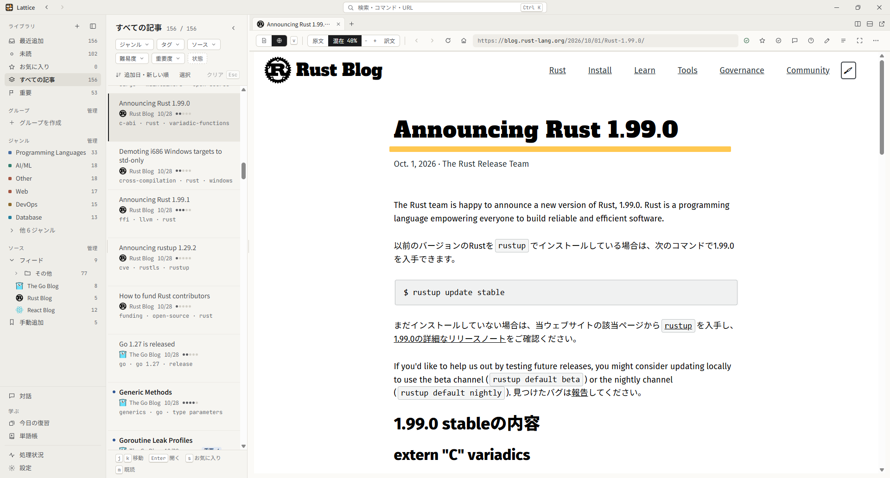

[English](README.md) | **日本語**

# Lattice

Latticeは、技術記事を集めて、翻訳しながら読み、あとから検索するためのWindowsアプリです。記事の本文と画像は自分のPCに保存するので、元のページが消えても読めます。翻訳・要約・質問への回答には、自分で選んだAI (ClaudeやCodexのCLI、OpenAI・Gemini・AnthropicのAPI)を使います。



<sub>画面に表示しているのはRust Blogの記事[Announcing Rust 1.99.0](https://blog.rust-lang.org/2026/10/01/Rust-1.99.0/)です。</sub>

## 部分翻訳で読む

Latticeのいちばんの特徴は、記事の一部だけを訳文にし、残りを原文のまま読めることです。

ツールバーで「混在」を選び、訳文にする割合(たとえば70%)を決めると、その割合の文を日本語で、残りの文を英語のまま表示します。割合は10%刻みで変えられ、下げるほど英語で読む部分が増えます。英語のまま読んでいて分からない段落があれば、その段落だけを訳文に切り替えられます。逆に、訳文の文にポインタを乗せると、原文を確かめられます。

保存した本文を表示するReader表示でも、元のWebページを表示するPage表示でも、同じように混ぜて読めます。日本語の記事は、逆に英語へ訳して混ぜます。もちろん、全文を原文のまま、または全文を訳文で読むこともできます。

この読み方は[Mazelingo](https://github.com/Yeq6X/mazelingo)に着想を得ています。訳文にする単位を決める処理と、Webページの上に訳文を表示する仕組みは、Mazelingoのコードを移植したものです。

## できること

- **記事を集める。** 記事は、URLを貼る、アプリ内ブラウザで見ているページを保存する、RSS / Atomフィードを登録する、ブックマークやURLの一覧・Markdown・論文のPDFを取り込む、のどれかの方法で入れます。JavaScriptで本文を組み立てるページは、描画してから本文を取り出します。フィードには、取り込む記事を選ぶフィルタを付けられます。
- **読む。** 抽出した本文を読むReader表示と、元のページをそのまま開くPage表示があり、どちらでも上の部分翻訳を使えます。記事の要約もAIが作ります。記事はタブで開き、画面を分割したり、別ウィンドウに出したりできます。
- **整理する。** AIがジャンル・タグ・難易度を付けます(あとから手で変えられます)。自分の関心に照らして、その記事がどれくらい重要かも判定します。自分でグループを作って記事をまとめることもできます。一覧はジャンル・タグ・未読などの条件を重ねて絞り込めます。
- **検索する・質問する。** キーワードの一致と意味の近さの両方で検索するので、日本語で探しても英語の記事の該当箇所が見つかります。対話ペインで質問すると、AIが保存した記事だけをもとに答えます。回答の引用を押すと、根拠の段落に移れます。
- **身につける。** 記事の内容を確かめるクイズをAIが作ります。分からない英単語は、出てきた文と一緒に登録できます。クイズと単語は、Ankiと同じ方式の間隔反復で復習できます。
- **データを守る。** データはすべて1つのSQLiteファイルに入っています。PC内へのバックアップ、Cloudflare R2への自動バックアップ、JSONへのエクスポートができます。

## インストール

Windows 11で動きます。[Releasesページ](https://github.com/Maru32768/lattice/releases)から、次のどちらかをダウンロードしてください。

- **インストーラー** (`Lattice_x.y.z_x64-setup.exe`): 通常はこちらを使います。新しいバージョンが出るとアプリ内で更新できます。必要ならMicrosoft Visual C++ ランタイムも一緒にインストールします。このとき管理者の承認を求めることがあります。
- **ポータブル版のzip**: 好きな場所に展開して`Lattice.exe`を起動します。データはすべて隣の`data`フォルダに保存します。自動更新はありません。

Latticeはまだ開発元の証明書で署名していないため、インストーラーや`Lattice.exe`を初めて実行すると「WindowsによってPCが保護されました」と表示されることがあります。上のReleasesページからダウンロードしたものであることを確かめてから、「詳細情報」を押し、続けて「実行」を押してください。

LatticeはWebView2を使います。WebView2はWindows 11には最初から入っています。ポータブル版では、WebView2とMicrosoft Visual C++ x64ランタイムが入っていなければ、自分でインストールしてください(同梱のCLIもこのランタイムを使います)。ランタイムはMicrosoftの[サポートされている最新のVisual C++ 再頒布可能パッケージ](https://learn.microsoft.com/ja-jp/cpp/windows/latest-supported-vc-redist?view=msvc-170#latest-supported-redistributable-version)のページから入手できます。

ソースからビルドする方法は[開発者向けガイド](docs/development.md) (英語)にあります。

## はじめ方

1. 左下の歯車から「設定」を開き、「AIプロバイダ」でプロバイダを1つ以上設定します。翻訳・要約・分類・対話・クイズにはAIプロバイダが必要です。記事の保存・閲覧・全文検索は、設定しなくても使えます。
2. `Ctrl+P`を押して記事のURLを貼り付け、「ライブラリに保存(取り込み)」を選びます。Latticeでは、保存した記事の集まりをライブラリと呼びます。
3. 記事一覧から記事を開き、ツールバーで「原文」「混在」「訳文」を切り替えます。「混在」か「訳文」に切り替えると、まだ訳していない記事なら翻訳が始まります。

フィードの登録はナビの「ソース」の横の「管理」から、ファイルの取り込みはナビの上端の ＋ (「記事を追加」)からできます。

## 詳しい使い方

[利用ガイド](docs/guide.ja.md)で、すべての機能を説明しています。よく参照するところ:

- [AIプロバイダを設定する](docs/guide.ja.md#aiプロバイダを設定する)
- [キーボードショートカット](docs/guide.ja.md#キーボードショートカット) (`Ctrl+P`でコマンドパレットが開きます。キーは「設定 › ショートカット」で変えられます)
- [データとバックアップ](docs/guide.ja.md#データとバックアップ)
- [プライバシーと安全](docs/guide.ja.md#プライバシーと安全) (AIプロバイダに何を送るか)

## CLIとMCP

同梱の`lattice-cli.exe`を使うと、保存した記事をターミナルから検索・閲覧できます。MCPサーバーとして動かせば、Claude CodeなどのAIエージェントからも記事を検索・閲覧できます。インストーラー版・ポータブル版のどちらでも、`Lattice.exe`と同じフォルダにあります。既定の場所にインストールした場合は、PowerShellで次を実行するとClaude Codeに登録できます。

```powershell
claude mcp add lattice -- "$env:LOCALAPPDATA\Lattice\lattice-cli.exe" mcp
```

保存した記事は他人が書いたWebページです。エージェントに読ませると、本文に仕込まれた指示に従ってしまうことがあります。エージェントに渡す前に、利用ガイドの[CLIとMCP](docs/guide.ja.md#cliとmcp)で、コマンドの一覧と、書き込みや危険な操作をエージェントにさせない設定を確認してください。

## 開発

ビルド・テスト・リリースの手順は[開発者向けガイド](docs/development.md) (英語)にあります。

## ライセンス

MITライセンスです([LICENSE](LICENSE))。[Mazelingo](https://github.com/Yeq6X/mazelingo)から移植したコードと、SIL Open Font Licenseのフォントを含みます。詳しくは[THIRD_PARTY_NOTICES.md](THIRD_PARTY_NOTICES.md)を参照してください。
