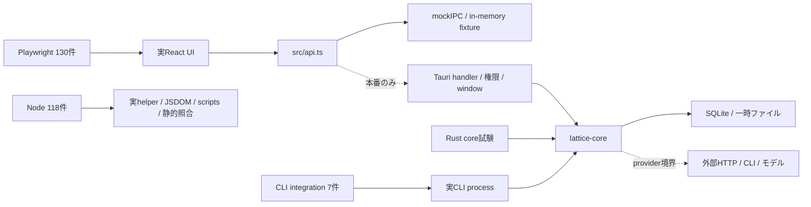

# 本番経路と重複の評価

[全件台帳](ledger.md) / [改善候補](findings.md) / [監査概要](README.md)

## 実行される本番コード

点線は、その接続を今回の該当テストが一続きに実行していない箇所。Rust provider試験はrequest/response変換や制御応答を使う。T035だけが実Codex呼出しだがignoreのため未実行。Tauriの26件はhelper・状態機械・一時ファイル操作等を直接実行し、nativeアプリを起動する26件ではない。

| 群 | 本物であるもの | 置換・未通過の境界 | 合格から言えること |
| --- | --- | --- | --- |
| Nodeの状態/文字列helper | 本番TS関数、固定期待値 | React配線・Rust | 入力例に対する状態更新・変換契約 |
| overlayのNode試験 | 本番DOM/logic関数、JSDOM | 実ページ・隔離world・WebView2 | DOM変換・sanitize・key判定の局所契約 |
| scripts/i18n静的gate | 実repo/カタログ/依存ファイル | 実配布物・実翻訳品質 | 版数・license・文字列整合の対象範囲 |
| Rust coreのDB試験 | Store/SQLite、migration、業務処理 | Tauri bridge・多くの外部取得/LLM | 一時DB上での保存制約・状態遷移・解析 |
| Rust provider試験 | 実adapterのbody/引数/parser | 実認証・API/CLI version差 | 記録したwire例との整合 |
| Rust Tauri試験 | label/nonce/geometry/state machine等 | 実window作成・OS配送・taskbar等 | 呼び出されたhelperの局所契約 |
| CLI integration | 実binary、stdio、exit code、一時DB | 実外部LLM | CLIからcoreへの接続と書込gate |
| Playwright | 実React・CSS・入力・Chromium・localStorage | Rust IPC・DB・job・native window | frontend操作とmock境界までの接続 |

`e2e/setup.ts`は[本番main.tsxをimport](../../e2e/setup.ts)する前に`mockIPC`・`mockWindows`・event mockを設定する。[harness.ts](../../e2e/harness.ts)はpageerror、console error、未対応commandを失敗にする。このためE2Eを「fixtureの文字列を見ているだけ」と一括して無価値にはできない。実UIの配線・例外・focus・geometryに検出力がある。

## 境界上の残存リスク

以下は低価値テスト20件とは別枠。モックの存在だけで既存テストを削除する提案ではない。追加するなら、該当境界を狭く直接検証する方が価値を得やすい。

### R01 — IPC名照合は完全な通信契約ではない

[T193](../../e2e/commands.test.ts#L6)は`src/api.ts`から正規表現で抽出した文字列invoke名と`Object.keys(handlers)`の集合を比較する。新commandのモック更新漏れを検出する有用なgate。一方、引数名/型、戻り値、[lib.rsのhandler登録](../../src-tauri/src/lib.rs)、[build.rsのCOMMANDS](../../src-tauri/build.rs)、[capability](../../src-tauri/capabilities/default.json)は比較していない。

したがって「名前がmockにあるので本番Tauriから呼べる」は成り立たない。今回、具体的な未登録commandを見つけたという指摘ではない。追加候補は契約manifestまたは少数の実Tauri呼出しsmoke。mock側を緩くする解決は避ける。

### R02 — Page・別窓・dragはnative結合部分が残る

[setup.ts](../../e2e/setup.ts)の説明どおり、他窓への`emit_to`はmockに吸収され、spec用に記録される。別窓はquery parameterのlabelを使うページとして起動し、drop/focusは人工eventで供給される。これで送り先・payload・受け手UIを別々に守れるが、同時に存在するnative二窓間で届くこと、window準備のrace、WebView2の重なり、monitor/DPI差までは確認しない。

Rust tabdrag 12件、TS layout 13件、E2E tabdrag 12件はそれぞれ座標/状態機械、tree変形、DOM/event配線を担当する。重複として削らない。追加候補は実Windowsでの「二窓間移動→元窓close」「tear-off準備前release」「異DPI monitor」の限定smoke。全座標unitをnativeテストへ置き換える必要はない。

### R03 — モックの即時完了はjob遷移を飛ばす

| 処理 | モック | 本番経路 | 残る確認 |
| --- | --- | --- | --- |
| quiz生成 | [mock.ts:425](../../e2e/mock.ts#L425)で即`generateQuiz` | [lib.rs:662](../../src-tauri/src/lib.rs#L662)でenqueue→worker通知→core quiz/job | pending表示、二重click、失敗/再試行、完了通知後の更新 |
| 単語登録 | [mock.ts:467](../../e2e/mock.ts#L467)で即ready語義/cardを追加 | [lib.rs:708](../../src-tauri/src/lib.rs#L708)でcapture→worker通知→語義job | pending語義、追加capture競合、失敗からの回復とUI更新 |
| 復習採点 | [mock.ts:447](../../e2e/mock.ts#L447)はgradeを使わずdue=false | [lib.rs:683](../../src-tauri/src/lib.rs#L683)でgradeと現在時刻をquizへ | grade別の次dueと日付跨ぎがUIへ届くこと |
| 翻訳/要約 | mockの集合・fixture/無操作handler | enqueue→翻訳/要約job→cache/イベント | pending/running/stale/failedを跨ぐ画面更新 |

core quiz/vocab/srs/jobsの試験は実SQLiteと制御応答で業務遷移を守るので価値が高い。UI側もhappy pathとして残す。追加候補は、モックに手動で進められるpending→failed/readyを用意してUI状態遷移を検証し、少数の実bridge/job結合試験で相互接続を確認すること。

### R04 — PDF・検索・設定の実処理はUI試験から外れる

[T251 PDF](../../e2e/pdf.spec.ts#L3)のmockはprepared articleを返す。本番の[import_pdf_file](../../src-tauri/src/lib.rs#L202)はdialog、file size、read、spawn_blocking parser、保存へ進む。T117〜T120とT085は実PDF bytes/parser/Storeを使うので代替不能。UI試験を実PDF解析の証拠にしない。

[E2E検索](../../e2e/search.spec.ts)はfixture hitで結果表示と操作を守る。実FTS/検索融合はT142/T143、snippetはT454〜T456。関連度品質・大規模corpusの検索評価は今回の試験群からは言えない。

設定mockはメモリ値で、native効果やDB再openはない（F07）。一方、pane幅・shortcut・tab layoutのlocalStorage reloadは実frontend経路なので、同じ「保存」でも判定を分けた。

### R05 — テスト側と本番側の実装共有

[mock.ts:59](../../e2e/mock.ts#L59)は本番`folderTree`と`placeFeeds`をimportする。そのためfeed順序E2Eを「backendにも独立に同じ順序計算があること」の証拠にはできない。もっとも、specは固定の期待順とUI操作をassertし、独立したRust feed_folders試験もあるため、これだけでE2Eを不要とはしない。

R2署名期待値の自己参照はF05。Reader/overlayとRustの言語判定は似た仕様の別実装で、片方を消すより共通入力corpusで差を検出する方がよい（F13）。本番関数で期待値そのものを作る方式と、本番関数をfixture backendの一部として使う方式は、検出力への影響が異なる。

### R06 — 外部サービス・OS固有機能のlive確認

API provider、CLI adapter、R2の多くはrequest/parser/署名・設定の契約試験。実サービスが現行requestを受け付けることや認証の有効性は未確認。T035 `live_codex_exec`は有償呼出しでignore、今回実行していない。文字列応答の疎通が目的で、翻訳品質の評価ではない。

音声は選択関数とspeech stub、taskbarは画像生成、updaterは鍵未設定/placeholderの無効化、保存場所は一時ファイルと選択規則が中心。OS実際の音声出力・taskbar表示・更新配信/署名/再起動は別途必要な場合に限定smokeを設ける。短いunitを全てlive試験へ置き換えると費用・不安定性が増えるので推奨しない。

## 重複に見えても維持する代表群

| 関連群 | 重複としない理由 | 判断 |
| --- | --- | --- |
| storeのmigration群T157〜T168と通常CRUD | 元schema・データ形状・移行時の履歴維持が違う。新規DB成功で旧DB移行は保証できない | 維持 |
| core feed_folders、TS feedFolders、UI feedorder/folders | SQL保存・楽観状態計算・入力配線が違う | 維持、mock共有を明記 |
| Rust tabdrag、TS layout/chrome、E2E tabs/popout/tabdrag | 座標選択・tree・DOM/host接続が違う | 維持、native結合は別 |
| core groupsとsrc/library/groups | 前者は多対多collection、後者は表示上のgenre/feed grouping | 名前が似るだけ。維持 |
| sanitize T440/T441 | script/handlerの基本削除と、難読scheme・data URLの許可/拒否が違う | 維持 |
| fetch/images/faviconsのprivate拒否 | 非信頼URLの入口が違い、入口ごとにguardの抜けを検出する | 維持 |
| main/document/chatのUI spec | host別の送受信・表示制約が違う | 維持。名称と操作のズレだけ改善 |
| 日本語/英語UIとi18n単体 | カタログ全体の整合、locale起動、DOM上の接続は相互代替できない | 維持。全カテゴリ列挙だけ補強 |
| CLI unitと実binary integration | 型変換/結果形状と、引数parser/stdio/write gate/exitが違う | 維持 |
| SRS計算とquiz/vocab/復習UI | 数式、DB登録/due、操作表示が違う | 維持。gradeを無視するmockを本番保証にしない |

部分的に同じassertionがあるだけでは削除しない。F14のように元assertion・前提状態を維持して同等の場所へ移せる場合のみ、統合候補とした。今回、統合による時間短縮のbenchmarkは行っていない。
